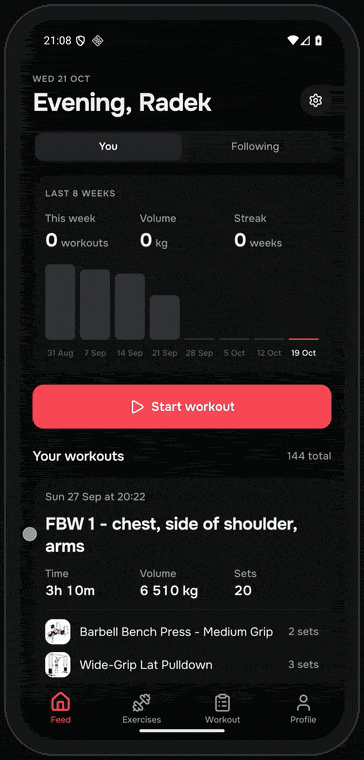
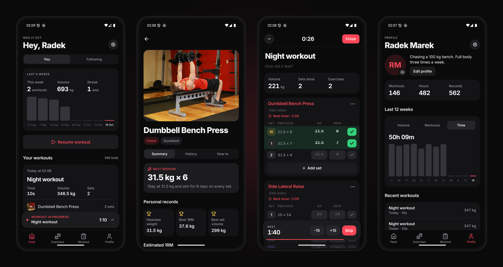
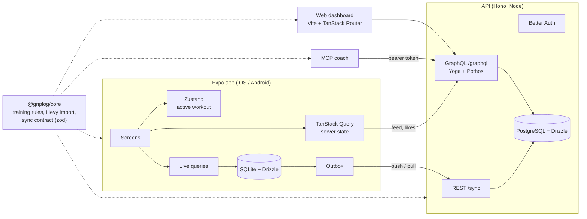
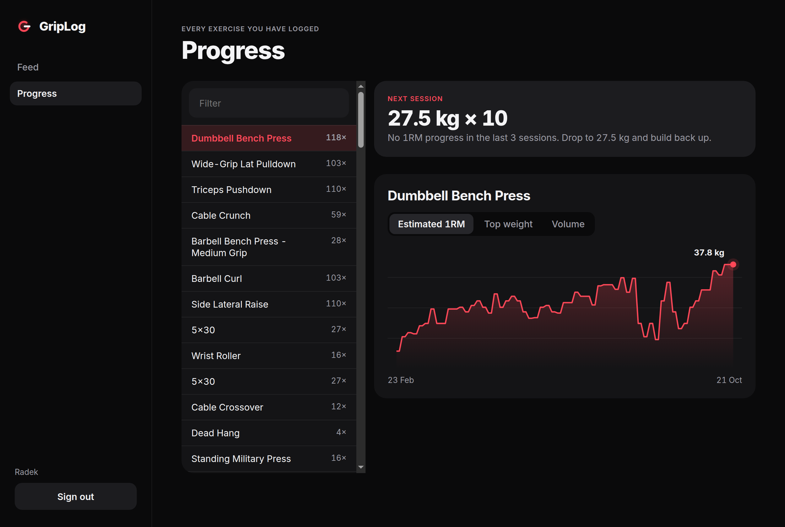

<div align="center">


# GripLog

**An offline-first workout tracker for iOS and Android, with a sync API, a social feed, a web dashboard and an AI coach that reads your real training data.**

[](https://github.com/Dotims/GripLog/actions/workflows/ci.yml)


[](LICENSE)



</div>

---

GripLog is the app I actually log my gym sessions in. It started as a Hevy replacement and grew into a full stack project: a React Native app that works with zero signal on the gym floor, a Postgres backed API that syncs it, a GraphQL feed for training with friends, a web dashboard for progress charts, and an MCP server that lets an assistant like Claude review your training using numbers computed by tested code instead of guesses.

My own history (144 workouts and 2 600+ sets exported from Hevy) imports in about a second, and everything you see in the recording and screenshots is that real data, captured from the app running in Expo Go on an Android emulator.

The interface is dark and quiet on purpose: you look at it between sets, often in a dim gym. Colour carries meaning only: red for actions and progress, green for completed sets, gold for personal records.

<p align="center">
  
</p>

## Features

**In the gym (fully offline)**

- Log sets with weight, reps and RPE, as normal, warm-up, drop or failure sets. Swipe a set to delete it.
- The "previous" column shows what you lifted last time; ticking an empty set fills it in.
- Rest timer that survives the app being killed and buzzes the locked phone with a local notification.
- 870+ exercises with photos (bundled, public domain), search, muscle filters and custom exercises.
- Routines, "repeat this workout" and "save as routine".
- Personal records (heaviest weight, estimated 1RM, best set volume, most reps) recomputed on every save, edit and delete.
- A next-session suggestion per lift: double progression, plus a deload after three sessions without progress.
- One-tap import of a Hevy CSV export, with a review step and safe re-runs.

**With an account**

- Background sync across devices. The phone stays the source of truth while you train.
- Follow friends, see their workouts in a feed and like them.
- A web dashboard with the feed and progress charts for every exercise.
- An MCP server, so Claude (or any MCP client) can answer "how is my bench going?" from your actual history.

## Architecture



The training logic lives in one pure TypeScript package, `@griplog/core`, used by the app, the API, the web dashboard and the MCP server. A 1RM estimate or a progression rule is written and tested once, and every surface shows the same number.

## Engineering notes

Things I deliberately built the hard way, because they are the interesting part.

### Transactions, end to end

- **Saving a workout is one SQLite transaction**: the workout row, its exercises and sets, the recomputed personal records and the sync outbox entry all land together or not at all. There is a test that breaks a foreign key halfway through and checks that nothing was written.
- **Transactional outbox**: every local write queues its aggregate in the same transaction, so a change can never be saved without also being queued for upload.
- **Pulled pages and the sync cursor commit together**, so a crash mid-sync re-fetches the same page instead of skipping it.
- On the server, a push is one Postgres transaction under a **per-user advisory lock**, so version numbers follow commit order and incremental pulls never miss a row.

### Sync that survives real networks

- **Idempotency keys**: each change has an id the server records. A phone that lost the response and retries gets "skipped", not a duplicate.
- **Last write wins** on `updatedAt`, and a guessed id can never overwrite another user's data (tested).
- **Poison messages are parked**: the client validates every payload with the same zod schema as the server. A bad change (my Hevy export contains a 2 505 kg curl) is set aside with a reason instead of blocking the queue, and a rejected batch is bisected to find the culprit.
- Pulls page per entity type with a cursor that may hold back but never skips a row.

### REST and GraphQL, each where it wins

- **REST for sync**: two fixed commands (`POST /sync/push`, `GET /sync/pull`) with plain status codes and validation.
- **GraphQL for the social feed and dashboards**: clients ask for exactly the fields a card shows, in one round trip. Per-request **DataLoaders** batch authors, sets and likes to avoid N+1 queries, and the feed uses **keyset pagination** on `(startedAt, id)` instead of `OFFSET`.

### State, by kind of data

| State                                 | Tool                                | Why                                                                                                                 |
| ------------------------------------- | ----------------------------------- | ------------------------------------------------------------------------------------------------------------------- |
| The running workout                   | **Zustand**, persisted to SQLite    | Changes on every keystroke; components subscribe to the slice they show, so typing a weight re-renders one set row. |
| Database handle, session, preferences | **React Context**                   | Global, rarely changes, read everywhere.                                                                            |
| Local tables                          | `useSyncExternalStore` live queries | First render already has data; one re-read per transaction, not per row.                                            |
| Server data (feed, likes, search)     | **TanStack Query**                  | Caching, infinite pages, optimistic likes with rollback.                                                            |

### Tests and CI

- **Vitest** for the core rules, the Hevy importer and the API. API tests run against a **real Postgres** (a service container in CI) and cover idempotency, last-write-wins, ownership, rollback and pagination.
- **Jest + React Native Testing Library** for repositories (real migrations on SQLite compiled to WebAssembly), the Zustand stores, the sync engine and components.
- **Maestro** flows in `apps/mobile/e2e` for logging a workout and creating a routine.
- **GitHub Actions** runs format, lint, typecheck and every test suite on each push and pull request.

## Tech stack

| Area       | Stack                                                                                                                                           |
| ---------- | ----------------------------------------------------------------------------------------------------------------------------------------------- |
| Mobile     | Expo SDK 57, React Native 0.86, React 19.2 with the React Compiler, Expo Router (typed routes), Reanimated 4, Gesture Handler, react-native-svg |
| Local data | expo-sqlite, Drizzle ORM and migrations, expo-secure-store                                                                                      |
| State      | Zustand, React Context, TanStack Query                                                                                                          |
| API        | Hono, Better Auth, Drizzle on PostgreSQL 17, zod, GraphQL Yoga, Pothos, DataLoader                                                              |
| Web        | Vite, React 19, TanStack Router, TanStack Query                                                                                                 |
| AI coach   | Model Context Protocol TypeScript SDK                                                                                                           |
| Quality    | TypeScript strict, ESLint, Prettier, Vitest, Jest, React Native Testing Library, Maestro, GitHub Actions                                        |

## Repository layout

```
apps/
  mobile/      Expo app: screens, SQLite data layer, sync engine
  api/         Hono server: auth, REST sync, GraphQL
  web/         Vite dashboard
  mcp/         MCP server for AI assistants
packages/
  core/        Training rules, Hevy importer, sync contract (zod)
  catalogue/   Exercise catalogue shared by the app and the API
```

## Getting started

You need Node 22+ and Docker.

```bash
npm install
docker compose up -d                      # Postgres on localhost:5440
cp apps/api/.env.example apps/api/.env    # set BETTER_AUTH_SECRET
npm run dev -w @griplog/api               # API on http://localhost:3000
```

**Mobile.** Install Expo Go (SDK 57) on your phone, then:

```bash
cp apps/mobile/.env.example apps/mobile/.env   # EXPO_PUBLIC_API_URL=http://<your LAN IP>:3000
npm run mobile                                  # scan the QR code with the camera
```

The app works without the API; an account only adds sync and the social feed. To bring your history over, export workouts from Hevy (Settings, Export & Import Data) and open **Import from Hevy**.

**Web dashboard.**

```bash
npm run dev -w @griplog/web     # http://localhost:5173, proxies /api and /graphql to the API
```

<p align="center">
  
</p>

**AI coach (MCP).** Create a token and register the server with your MCP client, for example Claude Code (run from the repository root):

```bash
npm run token -w @griplog/mcp -- you@example.com your-password
claude mcp add griplog -e GRIPLOG_TOKEN=<token> -e GRIPLOG_API_URL=http://localhost:3000 \
  -- npx tsx apps/mcp/src/index.ts
```

Then ask "review my last four weeks" or use the `review_my_training` prompt. Tools: `list_exercises`, `exercise_progress`, `recent_workouts`, `get_workout`, `training_overview`.

## Checks

```bash
npm run format:check
npm run lint
npm run typecheck
npm test            # API tests expect the Postgres from docker compose
```

## Roadmap

- [x] Offline app: library, routines, workouts, records, history, profile, Hevy import
- [x] Polish: animations, haptics, charts, rest notifications
- [x] API, accounts and sync
- [x] GraphQL social feed
- [x] Web dashboard
- [x] MCP coach
- [ ] iOS Live Activity for the rest timer and EAS builds
- [ ] Hosted API and web deploy
- [ ] In-app coach chat on top of the MCP tools

## Credits

- Exercise data and photos: [free-exercise-db](https://github.com/yuhonas/free-exercise-db) (public domain).
- Font: [Inter](https://rsms.me/inter/) (SIL Open Font License).

## License

[MIT](LICENSE) © Radosław Marek
