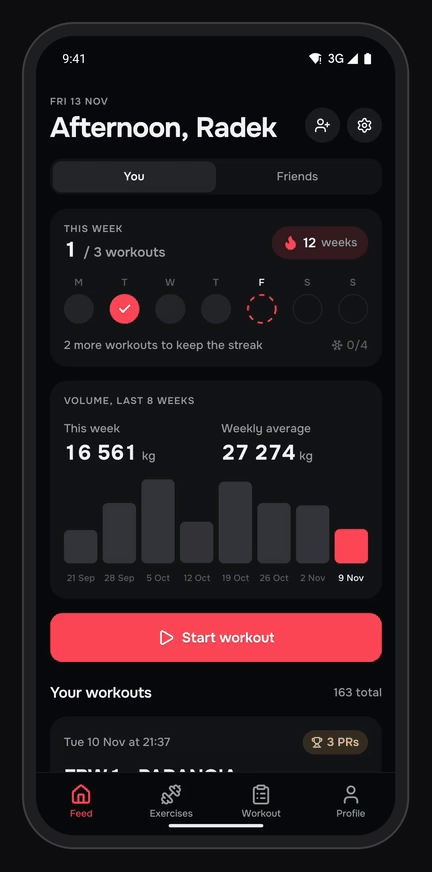
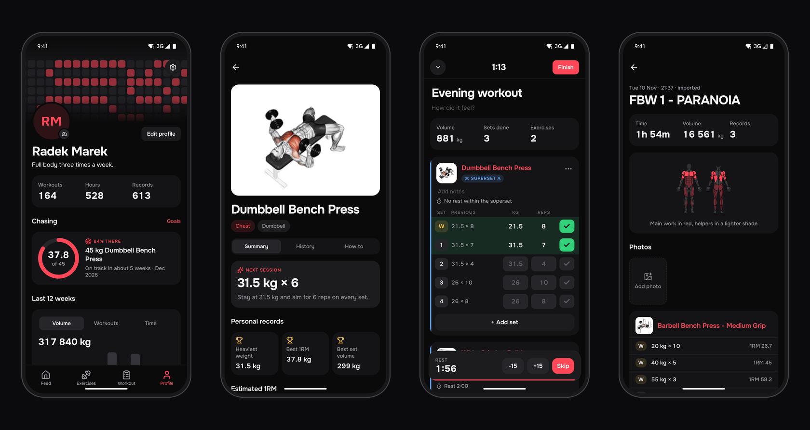
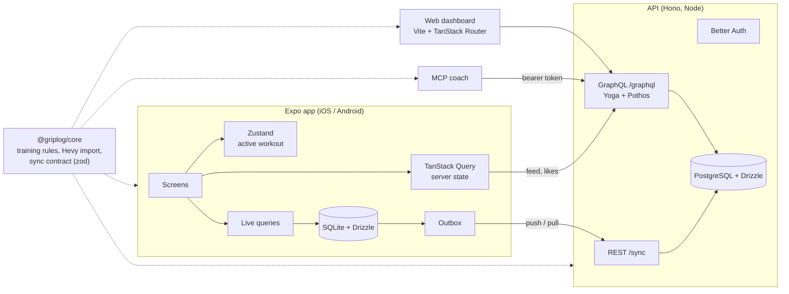
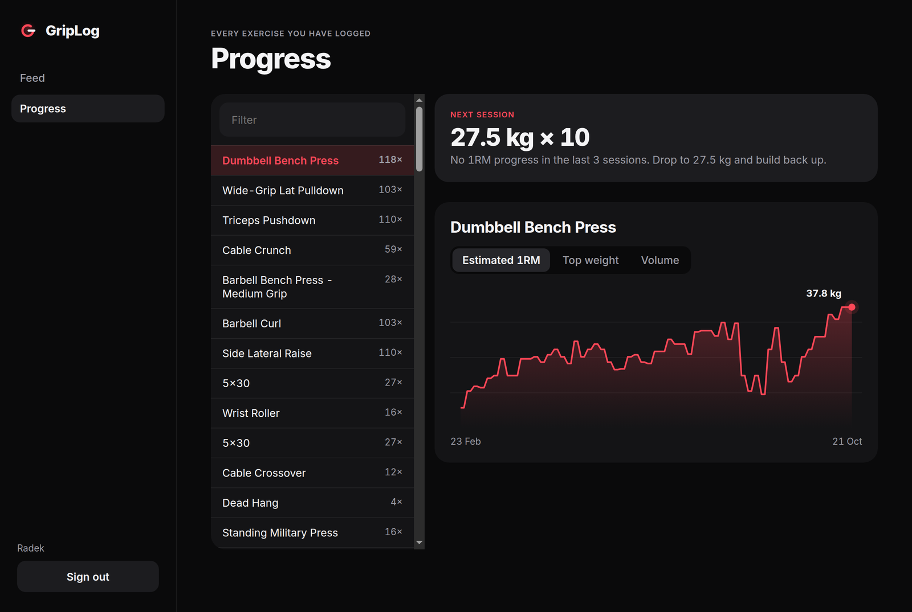

<div align="center">


# GripLog

Offline-first workout tracker for iOS and Android, with a sync API, a social feed, a web dashboard and an MCP server for AI assistants.

[](https://github.com/Dotims/GripLog/actions/workflows/ci.yml)


[](LICENSE)



</div>

I log my own gym sessions in GripLog; it started as a replacement for Hevy. The app keeps everything in SQLite on the phone and works with no signal. An account adds sync through a Hono and Postgres API, a feed of friends' workouts over GraphQL and a web dashboard with progress charts. There is also an MCP server, so an assistant such as Claude can answer questions about your training using numbers from the same tested code the app runs.

The recording and the screenshots show my real history: 163 workouts and about 3 250 sets imported from a Hevy export, captured in Expo Go on an Android emulator.

<p align="center">
  
</p>

## Features

### Logging, offline

- Sets with weight, reps and RPE, marked as normal, warm-up, drop or failure. Bodyweight exercises take reps only, timed ones (plank, carries) a time, cardio a distance and a time.
- A "previous" column with last time's numbers; ticking an empty set copies them in.
- A rest timer that survives the app being killed. On a locked phone a local notification says when rest is over.
- A library of 400+ exercises with animated demos, muscle filters, search and custom exercises. The lifts you do most often come first.
- Routines with a target per set: weight and reps, a rep range such as 8-12, or a time.
- Supersets in routines and during a workout. The rest timer starts after the last exercise of each round.
- Swipe a set to the left to delete it.
- Repeat a past workout or save it as a routine.
- Personal records (heaviest weight, estimated 1RM, best set volume, most reps), recomputed after every save, edit and delete.
- A front and back body map of the muscles each workout trained, also used as its thumbnail.
- Photos on workouts, from the camera or the library. They stay on the phone and fill the profile cover; without photos the cover shows the days you trained.
- A suggestion for the next session of each lift: double progression, and a 10 % deload after three sessions without a new best estimated 1RM.
- Import of a Hevy CSV export with a review step. Running it again skips the workouts that are already there.
- Sounds, which can be turned off: a tick per set, a bell when rest is over and a chime when a workout is saved.

### Goals

- A weekly goal, for example three workouts, and a streak of weeks that met it. Every four weeks on goal earn a freeze that covers one missed week.
- A lift goal such as a 100 kg bench. A ring shows the best estimated 1RM of the last twelve weeks against the target, and a least-squares trend over the same weeks gives the expected date.
- A summary after each workout with the week so far, the muscles trained and any new records.

### With an account

- Background sync between devices. While you train, the phone stays the source of truth.
- Find friends by name or in the suggestions, follow them and like their workouts in the Friends feed.
- A web dashboard with the feed and a progress chart for every exercise.
- An MCP server, so Claude or another MCP client can answer "how is my bench going?" from your history.

## How it works



The training rules (1RM estimates, progression, records, goals), the Hevy parser and the sync contract live in `@griplog/core`, a plain TypeScript package. The app, the API, the web dashboard and the MCP server all import it, so they compute the same numbers.

### Transactions

- Saving a workout is one SQLite transaction: the workout, its exercises and sets, the recomputed records and the outbox entry. A test breaks a foreign key halfway through and checks that nothing was written.
- Every local write adds its aggregate to an outbox table in the same transaction, so a change cannot be saved without being queued for upload.
- A pulled page and the sync cursor are committed together. After a crash in the middle of a sync, the app fetches the same page again.
- On the server a push is one Postgres transaction under a per-user advisory lock. Version numbers follow commit order, so an incremental pull never misses a row.

### Sync

- Every change carries an id that the server records. A retry of a change that already landed comes back as skipped, not as a second write.
- Conflicts resolve by last write wins on `updatedAt`. A guessed id cannot overwrite another user's row, and a test checks it.
- The client validates each payload with the server's zod schema. A change the server will never accept is parked with a reason so the rest of the queue keeps moving (my Hevy export has a 2 505 kg curl). When the server rejects a batch, the client splits it in halves until the bad change is alone.
- Pulls are paged per entity type, with a cursor that can hold back but never skips a row.
- Imported workouts get UUIDv5 ids from their start time and title, in a random namespace the server keeps for each account. The same Hevy file imported on two phones merges on sync instead of doubling, and no other account can predict those ids.
- New contract fields (superset numbers, rep ranges, timed targets) have defaults in the schema, so an older app version still pushes valid changes.

### REST and GraphQL

- Sync is REST: `POST /sync/push` and `GET /sync/pull`, with plain status codes and zod validation.
- The feed and the dashboard use GraphQL, so a client gets the fields a card shows in one request. Per-request DataLoaders batch the authors, sets and likes, so the feed does not run a query per card, and pages use a keyset on `(startedAt, id)` instead of `OFFSET`.

### State

| State                                 | Tool                                | Why                                                                                                 |
| ------------------------------------- | ----------------------------------- | --------------------------------------------------------------------------------------------------- |
| The running workout                   | Zustand, persisted to SQLite        | Changes on every keystroke; each set row subscribes to its own slice, so typing re-renders one row. |
| Database handle, session, preferences | React Context                       | Global, read everywhere, changes rarely.                                                            |
| Local tables                          | `useSyncExternalStore` live queries | The first render already has data, and a transaction triggers one re-read instead of one per row.   |
| Server data (feed, likes, search)     | TanStack Query                      | Caching, infinite pages, optimistic likes with rollback.                                            |

### Tests and CI

- Vitest covers the core rules, the Hevy importer, the API and the MCP server. The API tests run against a real Postgres (a service container in CI) and cover idempotency, last write wins, ownership, rollback and pagination.
- Jest and React Native Testing Library cover the repositories (real migrations on sql.js), the Zustand stores, the sync engine and components.
- Maestro flows in `apps/mobile/e2e` log a workout and create a routine.
- GitHub Actions runs format, lint, typecheck and every test suite on each push and pull request.

## Tech stack

| Area       | Stack                                                                                                                                           |
| ---------- | ----------------------------------------------------------------------------------------------------------------------------------------------- |
| Mobile     | Expo SDK 57, React Native 0.86, React 19.2 with the React Compiler, Expo Router (typed routes), Reanimated 4, Gesture Handler, react-native-svg |
| Local data | expo-sqlite, Drizzle ORM and migrations, expo-secure-store                                                                                      |
| State      | Zustand, React Context, TanStack Query                                                                                                          |
| API        | Hono, Better Auth, Drizzle on PostgreSQL 17, zod, GraphQL Yoga, Pothos, DataLoader                                                              |
| Web        | Vite, React 19, TanStack Router, TanStack Query                                                                                                 |
| AI coach   | Model Context Protocol TypeScript SDK                                                                                                           |
| Quality    | TypeScript strict, ESLint, Prettier, Vitest, Jest, React Native Testing Library, Maestro, GitHub Actions                                        |

## Repository layout

```
apps/
  mobile/      Expo app: screens, SQLite data layer, sync engine
  api/         Hono server: auth, REST sync, GraphQL
  web/         Vite dashboard
  mcp/         MCP server for AI assistants
packages/
  core/        Training rules, Hevy importer, sync contract (zod)
  catalogue/   Exercise catalogue shared by the app and the API
```

## Getting started

You need Node 22+ and Docker.

### API

```bash
npm install
docker compose up -d                      # Postgres on localhost:5440
cp apps/api/.env.example apps/api/.env    # set BETTER_AUTH_SECRET
npm run dev -w @griplog/api               # API on http://localhost:3000
npm run db:seed-demo -w @griplog/api      # optional: three demo friends with recent workouts
```

### Mobile

Install Expo Go (SDK 57) on your phone, then:

```bash
cp apps/mobile/.env.example apps/mobile/.env   # EXPO_PUBLIC_API_URL=http://<your LAN IP>:3000
npm run mobile                                  # scan the QR code with the camera
```

The app works without the API; an account only adds sync and the social feed. To bring your history over, export your workouts from Hevy (Profile, Settings, Export & Import Data, Export Workouts) and open Import from Hevy in the app.

### Web dashboard

```bash
npm run dev -w @griplog/web     # http://localhost:5173, proxies /api and /graphql to the API
```

<p align="center">
  
</p>

### MCP server

Create a token and register the server with your MCP client, for example Claude Code (run from the repository root):

```bash
npm run token -w @griplog/mcp -- you@example.com your-password
claude mcp add griplog -e GRIPLOG_TOKEN=<token> -e GRIPLOG_API_URL=http://localhost:3000 \
  -- npx tsx apps/mcp/src/index.ts
```

Then ask "review my last four weeks" or use the `review_my_training` prompt. Tools: `list_exercises`, `exercise_progress`, `recent_workouts`, `get_workout`, `training_overview`.

## Checks

```bash
npm run format:check
npm run lint
npm run typecheck
npm test            # API tests expect the Postgres from docker compose
```

## Not done yet

- EAS builds and an iOS Live Activity for the rest timer
- A hosted API and web dashboard
- Coach chat inside the app, on top of the MCP tools

## Credits

- Exercise data and photos: [free-exercise-db](https://github.com/yuhonas/free-exercise-db) (public domain).
- Exercise animations: [ExerciseDB](https://github.com/ExerciseDB/exercisedb-api), © [Gym visual](https://gymvisual.com/). The app streams them from the ExerciseDB CDN and the repository does not store them; `packages/catalogue/data/animations.json` holds only the matched ids, built by `npm run animations -w @griplog/catalogue`.
- Font: [Onest](https://fonts.google.com/specimen/Onest) (SIL Open Font License).
- Body map: [react-native-body-highlighter](https://github.com/HichamELBSI/react-native-body-highlighter) (MIT).

## License

[MIT](LICENSE) © Radosław Marek
